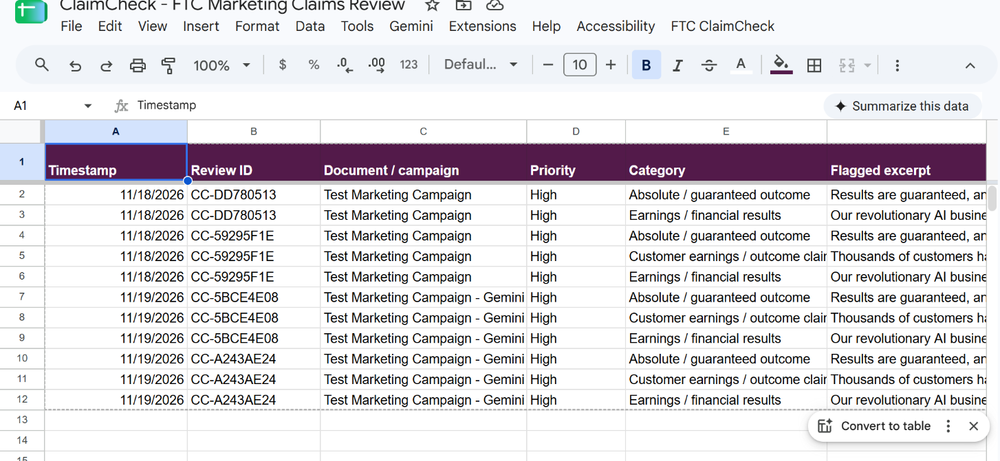
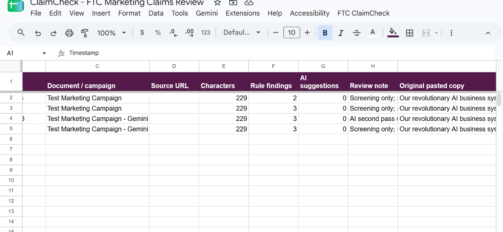

# ClaimCheck for Google Sheets

**Paste the copy. Find the claims. Ask better questions.**

A Google Apps Script editorial preflight tool for marketing copy. Open a custom menu in Google Sheets, paste a landing page, sales email, ad, or article into a sidebar, and get a structured list of **claims to investigate before publication**—with reasons, reviewer questions, links to FTC guidance, and a space to document the outcome.

**This is not an FTC compliance certification or legal advice.** It uses selected text patterns to prompt human review, not to determine whether claims are true, deceptive, or lawful. A document with zero flags is not necessarily compliant.

## Why I built it

While working as a content writer at Publishing.com in 2024–2025, I researched FTC advertising guidance and reviewed and revised approximately 200 marketing articles during an investigation. That work underscored how often a single sentence can hide a factual, evidentiary, or disclosure question. I wanted an editorial tool that would **surface those questions early rather than pretend to replace the editor**.

This is a new, independently built Google Apps Script project informed by that experience. It is **not** an employer system, and it contains no employer content or proprietary data.

## What it does

1. Adds **FTC ClaimCheck** to a Google spreadsheet's menu bar.
2. Opens a **Paste Copy & Review** sidebar with a name, optional source URL, and copy field (up to 30,000 characters).
3. Applies **12 transparent, editable rule categories** to the pasted text, including earnings promises, guarantees, health claims, testimonials, free offers, superlatives, AI capability claims, environmental claims, urgency, and material connections.
4. Saves a review record and full pasted copy in **`ClaimCheck_Reviews`**.
5. Writes individual review points to **`ClaimCheck_Findings`**, with a priority, original excerpt, why it merits review, a concrete verification question, official FTC guidance, and editable reviewer status/notes.
6. Optionally requests an **additional Gemini second pass** if an API key is configured **and** the reviewer explicitly opts in. The default rules-only workflow needs no API key, uses no external API, and makes no crawling requests.
7. Also supports **Review Selected Cell** if the copy is already in a sheet cell.

The editor makes the final decision; the software makes the questions difficult to overlook.

## Live application screenshots

These screenshots show ClaimCheck **running inside Google Sheets** with **fictional test copy**, not customer or employer material. The sidebar displays the actual review findings; the review-history tab records the rule-based runs and optional Gemini attempt. Browser chrome containing account information has been cropped out.





The original test flagged two potential claims; a later rule change detected a third, previously missed customer earnings claim. These are **possible editorial review issues**, not findings of illegality. The Gemini second pass returned zero additional suggestions in the most recent test; its successful execution has **not** been independently confirmed.

For historical reference, the project also includes simulated browser previews in `screenshots/01-sidebar-local-preview.png` and `screenshots/02-findings-local-preview.png`.

## Install it in Google Sheets (no terminal required)

This project is a **container-bound Google Apps Script**. It runs in a Google spreadsheet, not as a GitHub Pages site.

1. Create a **new Google Sheet**, for example `ClaimCheck – Editorial Review`.
2. Open **Extensions → Apps Script**.
3. Open the default `Code.gs` and **replace its contents** with this repository's `Code.gs`.
4. Click **+ → Script** and create a file named `Rules`. Paste the contents of `Rules.gs`.
5. Create a script file named `Gemini`. Paste `Gemini.gs`. It is included even if you never use the optional AI feature.
6. Create a script file named `Tests`. Paste `Tests.gs`.
7. Click **+ → HTML** and name it `ReviewSidebar`. Paste the **entire contents** of `ReviewSidebar.html` into that HTML file, replacing any default markup.
8. Save all changes. The Apps Script editor uses the V8 runtime by default. You can optionally reveal the manifest in **Project Settings → Show "appsscript.json" manifest file in editor** and paste this repository's `appsscript.json`.
9. Return to the spreadsheet and **reload the page**. You should see the **FTC ClaimCheck** custom menu.
10. Choose **FTC ClaimCheck → Paste Copy & Review**. On first use Google may request authorization to access this spreadsheet. Review the permissions and authorize your own project if comfortable.
11. Paste the invented test text from [`examples/sample-marketing-copy.txt`](examples/sample-marketing-copy.txt), select **Review copy & save findings**, and inspect the two sheets created automatically.

**No web app deployment is needed.** The script and menu are attached directly to your spreadsheet. Official setup reference: [Google Apps Script: container-bound scripts](https://developers.google.com/apps-script/guides/bound).

### Google may show an unverified-app warning

Personal Apps Script projects can prompt a warning during authorization because they have not undergone public OAuth app verification. This does not prove the script is safe. **Read the code and the requested permissions before granting access**, and use a test spreadsheet first.

## Optional: enable Gemini as a second reviewer

The rule-based workflow works independently. Gemini is **off by default**.

1. In the Apps Script editor open **Project Settings → Script Properties**.
2. Add `GEMINI_API_KEY` with a key obtained through your own Google AI Studio project.
3. Optional: add `GEMINI_MODEL` with a model available to your account; this sample defaults to `gemini-2.5-flash` and may require changing as model availability changes.
4. Reload the spreadsheet, open the ClaimCheck sidebar, and choose the **Gemini second pass** checkbox only when you intend to send that particular text to the Gemini Developer API.
5. Rule-based findings still save if the Gemini request fails; the sidebar reports the optional AI error.

**Privacy and cost:** Pasted copy is saved in the spreadsheet. With Gemini disabled, the script does not send the copy to an outside AI service. With Gemini enabled, the copy (up to 18,000 characters), along with matched rule excerpts, is sent to Google's Gemini API. You are responsible for permissions to transmit any unpublished, client, or confidential copy. API fees, quotas, and model availability depend on your own Google project. **Do not commit credentials or add keys to spreadsheet cells.**

Gemini suggestions are labeled separately in the `Detection method` column and require verification. AI cannot issue legal determinations.

## Review workflow

The `ClaimCheck_Findings` tab includes a controlled **Reviewer status** column:

- Needs review
- Evidence requested
- Revised
- Supported after review
- Not applicable

Use **Reviewer notes** to record substantiation, factual corrections, disclosure decisions, and why the wording was accepted or revised. These are editorial workflow statuses, not legal judgments.

Every review receives a unique ID that connects its findings to its full copy in `ClaimCheck_Reviews`. Reviews are appended; the script does not overwrite prior reviews.

## Rule coverage and source references

See [`docs/ftc-guidance-map.md`](docs/ftc-guidance-map.md) for the 12 review categories, intended editorial questions, and links to official FTC material. The links are starting points for review, not automatic evidence of a violation.

### The important limitations

- **False negatives:** No matches does not mean the copy complies with the FTC Act. Claims can be implied by context, images, endorsements, formatting, omissions, or a combination of elements.
- **False positives:** Pattern matches can flag permissible, already-substantiated, quoted, or non-advertising uses of a phrase.
- **Disclosure context:** Plain text can't assess whether a disclosure is sufficiently prominent, placed near a claim, or visible on mobile devices.
- **Evidence:** The tool cannot establish whether a scientific study, financial dataset, testimonial, or comparison substantiates the actual claim.
- **Legal scope:** It doesn't cover every FTC statute, rule, industry-specific requirement, state law, or changing regulatory standard.
- **Scope:** Manual pasted copy and selected spreadsheet cells only. No live crawling, browser scraping, automatic publication, or legal certification.
- **Gemini:** Optional suggestions can be inaccurate. An AI response error does not block or invalidate the rule-based review.

## Repository map

```text
Code.gs                       Spreadsheet menu, sidebar, persistence and review IDs
Rules.gs                      Pattern-based review engine and official FTC links
Gemini.gs                     Optional consent-gated Gemini API second pass
Tests.gs                      In-Sheets smoke tests
ReviewSidebar.html            Pasted-copy UI built with HTML/CSS/JavaScript
appsscript.json               Apps Script V8 manifest
examples/sample-marketing-copy.txt
examples/example-findings.csv Synthetic example output (not legal results)
screenshots/*.png             Live Google Sheets captures and labeled local browser previews
docs/architecture.md          Workflow, permissions, privacy and data design
docs/ftc-guidance-map.md      Rule categories, sources and limitations
docs/test-results.md          Recorded test scope and results
docs/blog-story-outline.md   Personal technical case-study outline
tests/*.test.cjs              Node tests for the same rule engine and mocked Sheets
```

## Testing

Run locally (Node.js 18+):

```bash
node --test tests/*.test.cjs
```

The Node suite exercises actual `Rules.gs` code and uses mock Google Sheets services to test review persistence. You can also run **FTC ClaimCheck → Run Self-Tests** inside Google Sheets after installing the project. See [`docs/test-results.md`](docs/test-results.md) for what has and has not been verified.

**A passing pattern test is not a legal-accuracy benchmark.** This code has not been evaluated against a labeled dataset of FTC enforcement findings. In November 2026, a live Google Sheets test confirmed the sidebar, rule-based analysis, saved review records, and findings persistence with fictional copy. The Gemini second pass has not yet been conclusively verified.

## Portfolio framing

**Original authoring:** This is a new Google Apps Script tool inspired by firsthand work reviewing advertising claims—not a recreation of a previous employer's proprietary system. The implementation deliberately treats **AI as an optional, reviewable assistant**, while preserving the editorial decision and supporting rationale in Google Sheets.

Technologies: Google Apps Script, JavaScript, Google Sheets, HTML/CSS, Google Workspace custom menus, regex/text processing, structured review logging, optional Gemini API, unit/integration testing.

---

*An editorial aid for identifying possible issues—not an FTC endorsement, audit, certification, or substitute for qualified legal review.*
